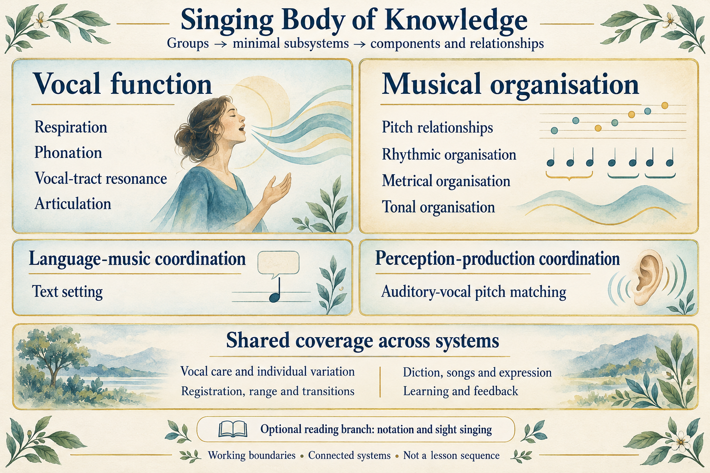

# Singing KPS

## Key takeaway

Begin with one comfortable, observable singing task rather than memorising an entire singing curriculum.

## Summary

Singing KPS is an independent, source-linked beginner learning package using the Knowledge Practice System authoring language 9.x and the inspected Core 11.0.0 conventions. It offers a first humming and rhythm exercise and a separate ear-first reference-pitch task. No musical notation, prior training, fixed vocal range or performance experience is assumed.

The overview summarises the [Body of Knowledge Outline](docs/body-of-knowledge-outline.md). Start with the [complete topic outline](docs/body-of-knowledge-outline.md#overall-outline) to distinguish organising groups, minimal subsystems, their components and shared topics, then follow the coverage tables for required understanding, intended capabilities and gaps. The existing [detailed topic pictures](docs/body-of-knowledge-outline.md#optional-detailed-illustrations) remain optional supporting views. The current lessons support two limited beginner tasks; the outline defines the broader knowledge to develop.

## Start here

Read [First singing session](practices/first-singing-session.md). It offers a gentle three-note contour over four beats, with explicit stop conditions and a simple way to decide what to practise next. An optional voice recorder may help you listen back; the exercise does not require a keyboard or an app.

For an external target, use [Match a reference pitch](practices/match-a-reference-pitch.md): choose a comfortable bundled tone, listen, attempt, compare and decide. Only audio playback is required; recording and tuning tools are optional. Start with [the reference bank](media/reference-pitches/README.md) when checking playback. An uncertain comparison is a valid result, not a reason to keep guessing.

Do not practise through pain, hoarseness, illness-related voice changes or persistent vocal fatigue. The [NIDCD voice care guidance](references/nidcd-2025-taking-care-of-your-voice.md) identifies warning signs and when to seek professional help.

## Knowledge coverage

Use the [Body of Knowledge Outline](docs/body-of-knowledge-outline.md) to understand what this subject needs to cover and how deeply. Required topics stay visible even when no local explanation exists. Each Practice supplies its own activity order and entry conditions. The package currently includes:

- [Voice production](concepts/voice-production.md) explains how voiced sound is generated and shaped.
- [Pitch](concepts/pitch.md) distinguishes matching, contour and octave placement without requiring note naming.
- [Pitch relationships](models/pitch-relationships.md) connects pitch height, pitch class, octave and interval in worked comparisons; it separates a matching target from a contour.
- [Intonation](concepts/intonation.md) explains accuracy relative to a target and uncertainty in judging it.
- [Beat and rhythm](concepts/beat-and-rhythm.md) separates the pulse from durations and silence.
- [First singing session](practices/first-singing-session.md) integrates these ideas into a small task.
- [Match a reference pitch](practices/match-a-reference-pitch.md) supplies a selectable audio reference and an observation loop.
- [Reference pitch comparison](methods/reference-pitch-comparison.md) explains replay, direction, optional feedback and uncertainty.
- [Auditory vocal pitch matching](models/auditory-vocal-pitch-matching.md) presents a limited, proposed functional model, not an individual diagnosis.

The Principles directory remains intentionally empty. KPS does not require manufacturing one object per role.

## Evidence and limits

The external References record what was inspected and what the sources do not establish. The exercise order, patterns, reference selection and qualitative reporting are authored KPS applications; they are not a clinically validated protocol or a guarantee of singing improvement. This repo does not assess voice disorders or replace personalised instruction.

## Compatibility

For repository work, follow [Agent guidance](AGENTS.md), including the shared Core Engineering Principles and the pinned validation procedure.

The package targets [KPS Core 11.0.0](https://github.com/xiongxianfei/knowledge-practice-system) and the KPS 9.x authoring format. Its metadata is in [publication.json](publication.json). GitHub Actions runs the structural KPS 9.1.0 validator from a pinned upstream commit. The audio check additionally verifies generated file integrity and pitch, not user playback or singing. A passing structural check does not establish medical safety, factual correctness or learning effectiveness.
