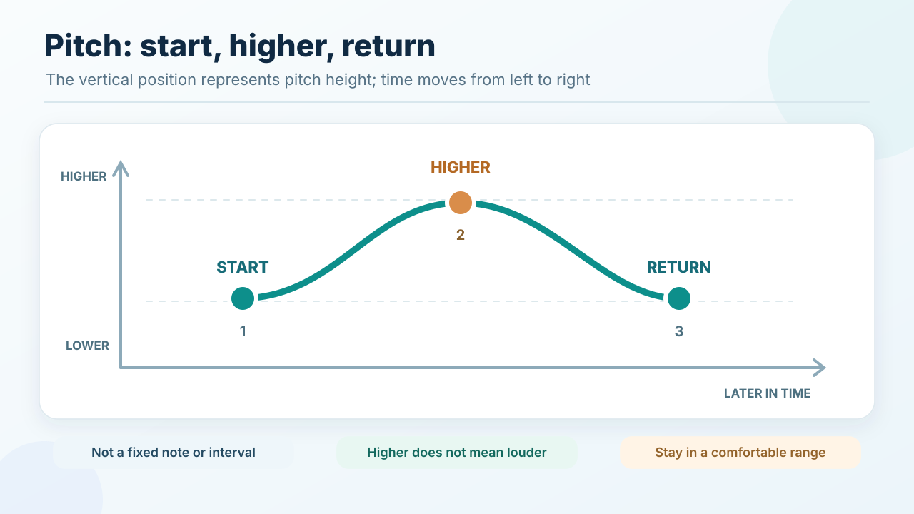

# Pitch

## Key takeaway

Pitch is the quality by which we hear one musical tone as higher or lower than another.

## Summary

A beginner can distinguish a note that stays the same from one that moves higher or lower without knowing note names. In common Western notation, higher pitches are written higher on the staff, and a higher fundamental frequency generally corresponds to a higher-sounding steady tone.

## Meaning

For this introductory task, compare two reasonably steady voiced sounds:

- **Same** means they seem to have approximately the same pitch.
- **Higher** means the second tone sounds above the first.
- **Lower** means the second sounds below the first.

Pitch is not loudness. A person can produce a quiet high note or a loud low note. Singing *in tune* with a reference means reproducing an intended pitch relationship accurately; simply noticing the direction of a change is a more modest first task.

## See the relative pitch contour

The illustration shows the **relative direction** of three notes; it does not set a pitch, interval or singing volume. The first and third pitches are intended to be near one another. The middle tone is higher, not necessarily louder.

## Example and limit

A simple sung contour can be represented as **starting pitch, somewhat higher pitch, return toward starting pitch**. These are relationships, not named musical notes or a measured tuning assessment. If it is not clear which note is higher, repeat gently or ask a teacher to demonstrate rather than forcing your vocal range.

The source treats Western staff notation. Its conventions are not a universal notation system, and the KPS humming exercise is our own beginner application.

## Source alignment

[Open Music Theory Notation of Notes](../references/open-music-theory-undated-notation.md), Key Takeaways and Clefs. Relation: definition paraphrase with limits.