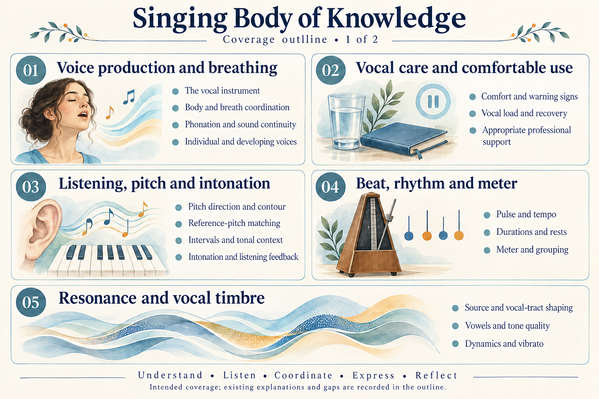
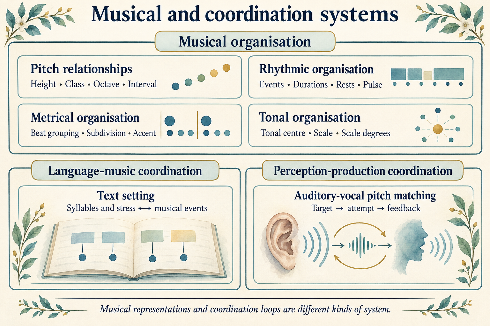

# Singing Body of Knowledge Outline

## Key takeaway

Define the knowledge a beginner needs to understand singing, learn a suitable song and make informed practice choices. Keep required topics visible even when no local explanation exists yet.

## Summary

This outline specifies intended coverage across voice function, musicianship, words, performance and learning. It adapts established subject structures to a beginner-facing project, then maps existing explanations and gaps against concrete learning outcomes. The ten areas and their subdivisions are our selected organisation, not a universal singing taxonomy or an examination syllabus.

The implemented package contains four Concepts, a comparison Method, a proposed functional Model and two Practices: [First singing session](../practices/first-singing-session.md) and [Match a reference pitch](../practices/match-a-reference-pitch.md). The latter adds selectable reference audio, octave-aware comparison and explicit uncertainty for one short note. The broader outcomes below describe future coverage, not lessons already supplied or competence already demonstrated. Concepts, Principles, Models, Methods and Practices remain the knowledge roles; several topics may share an explanation.

## Overall outline

The complete selected scope is ten knowledge areas and 34 topics. This table shows what needs to be covered; follow an area to its required depth, existing explanations and gaps. Numbers identify areas, not a compulsory learning order.

| Area | Topics to cover |
|---|---|
| 1. [Voice production and breathing](#voice-production-and-breathing) | The vocal instrument; body and breath coordination; phonation and sound continuity; individual and developing voices |
| 2. [Vocal care and comfortable use](#vocal-care-and-comfortable-use) | Comfort and warning signs; vocal load and recovery; appropriate professional support |
| 3. [Listening pitch and intonation](#listening-pitch-and-intonation) | Pitch direction and contour; reference-pitch matching; intervals and tonal context; intonation and listening feedback |
| 4. [Beat rhythm and meter](#beat-rhythm-and-meter) | Pulse and tempo; durations and rests; meter and grouping |
| 5. [Resonance and vocal timbre](#resonance-and-vocal-timbre) | Source and vocal-tract shaping; vowels and tone quality; dynamics and vibrato |
| 6. [Registers range and transitions](#registers-range-and-transitions) | Register terminology; range and tessitura; transitions and coordination |
| 7. [Articulation vowels and diction](#articulation-vowels-and-diction) | Vowels and consonants; pronunciation and meaning; text and musical timing |
| 8. [Notation and sight singing](#notation-and-sight-singing) | Reading written pitch; reading rhythm and directions; from notation to sound |
| 9. [Songs phrasing and performance](#songs-phrasing-and-performance) | Repertoire selection; phrasing and expression; style and musical context; singing with others and presenting |
| 10. [Practice feedback and skill development](#practice-feedback-and-skill-development) | Choosing a practice task; separating and combining skills; observations and recording limits; retention and transfer |

## Illustrated coverage

### Areas 1 to 5

[Open the foundations illustration at full size](../diagrams/body-of-knowledge-outline-foundations.png).

### Areas 6 to 10

[Open the musical practice illustration at full size](../diagrams/body-of-knowledge-outline-musical-practice.png).

These original AI-generated illustrations summarise all 34 topics across ten areas. Numbers identify areas, not lesson order. Singers, keyboards, letters and musical motifs identify subjects; they are not anatomical diagrams, posture instructions, a complete sound inventory or exercise notation. The tables below retain the required depth and current gaps. [Generation and refinement prompts](../diagrams/body-of-knowledge-outline.prompt.txt) are saved beside the images.

## Intended practices and depth

The target is to help a beginner understand what a singing task asks, learn a short suitable song, distinguish pitch, timing, words and expression, and choose a useful next practice step. Learning by listening and imitation is included. Western notation is an additional reading skill, not an entry requirement or a representation of every musical tradition.

Expected depth is stated as an observable understanding or capability in each row. Some outcomes require comparison or explanation; others involve applying knowledge to an appropriate task. They are authored development goals, not a prescribed exercise sequence, a fixed vocal range, a grading scale or a promise of improvement. A Practice must provide its own prerequisites, procedure and support before a vocal activity is introduced.

The existing [starting conditions](../practices/first-singing-session.md#starting-conditions) continue to govern the first session. Do not sing through pain, hoarseness or unusual fatigue; persistent voice problems call for clinical advice. Comfort is a useful observation, not medical clearance. This outline introduces no new vocal exercise or treatment. The [voice-care Reference](../references/nidcd-2025-taking-care-of-your-voice.md) records the health guidance behind those boundaries.

## Source basis and selection

| Established account | Contribution | Adaptation and inspection limits |
|---|---|---|
| [NATS voice-pedagogy syllabus](../references/nats-undated-voice-pedagogy-syllabus.md) | Voice function, perception, development and learning | Pages 1-3 provide the subject structure. We select learner-relevant topics; teacher training, studio management and the university timetable are not adopted. |
| [Trinity singing syllabus](../references/trinity-2026-singing-syllabus.md) | Vocal and musical performance, diction, interpretation and reading | Selected pages 25-26, 39 and 69 connect these areas. We use their distinctions, not repertoire, exercises, marking rubrics or grade progression. |
| [Open Music Theory notation](../references/open-music-theory-undated-notation.md), [rhythm](../references/open-music-theory-undated-notating-rhythm.md), [meter](../references/open-music-theory-undated-simple-meter.md) and [sight singing](../references/open-music-theory-undated-sight-singing.md) | Musical foundations and separating reading difficulties | The existing records support the adopted Western-theory account. Wider tonal and listening goals below need additional source work before local lessons are written. |
| [NIDCD voice care](../references/nidcd-2025-taking-care-of-your-voice.md) | Voice production, general care and recognising when to seek help | General guidance supplies boundaries, not a personalised technique prescription or diagnosis. |

On 2026-10-14 the NATS syllabus text, the identified Trinity passages and relevant NIDCD HTML sections were rechecked. Fresh access to the Open Music Theory notation and sight-singing chapters failed; their contributions rely on the recorded 2026-10-13 inspection. No new inspection of linked textbooks, scores, recordings or learner performances is claimed.

For the reference-pitch task, the [ASPN chapter](../references/open-music-theory-undated-aspn.md) was inspected through its credited republication, and [UNSW note frequencies](../references/wolfe-undated-note-frequencies.md) supplied the tuning equations. [Blanco 2021](../references/blanco-2021-pitch-matching-feedback.md) supplies a reference-replay procedure and feedback-condition evidence; [Pfordresher 2015](../references/pfordresher-2015-singing-accuracy-framework.md), including Figure 1, supplies a proposed functional account. These additional 2026-10-14 inspections do not establish the effectiveness of our ear-only adaptation. Reference records retain the actual inspected extent and limitations.

NATS addresses future teachers, while Trinity addresses assessment and Open Music Theory supplies musical foundations. Their purposes differ. The following scope selects and combines subjects for learning to sing; it does not transfer professional qualifications or exam expectations to beginners. Detailed mechanisms, disputed terminology and future exercises still require claim-specific evidence.

## Reading the coverage tables

Each row defines a topic, the knowledge it needs and an expected outcome before listing existing material. **Partial** means a local explanation or Practice contributes but does not fulfil the whole row. **Source only** means an external account is recorded but the local lesson is missing. **Missing** means no focused local explanation has been identified. These are coverage descriptions, not measures of singing ability or evidence of completed practice.

## Voice production and breathing

| Topic | Required coverage | Expected depth | Existing explanations and gaps |
|---|---|---|---|
| The vocal instrument | Breath supply, vocal folds, vocal tract and their distinct contributions | Explain where voiced sound begins and how it is shaped without treating an image or sensation as an anatomical measurement. | **Partial:** [Voice production](../concepts/voice-production.md). A fuller functional representation is missing. |
| Body and breath coordination | Movement, breathing and phrase demands; limits of posture and support metaphors | Describe the coordination a short phrase requires and distinguish an observation from a teacher's cue. | **Source only:** [NATS syllabus](../references/nats-undated-voice-pedagogy-syllabus.md). Local breathing and coordination explanations missing. |
| Phonation and sound continuity | Starting, sustaining and ending voiced sound; relationship to airflow and articulation | Identify the intended start and release of a phrase and explain which parts of voice function are involved. | **Partial:** voice-production Concept; onset, release and continuity explanations missing. |
| Individual and developing voices | Variation between people, changing voices and limits of comparisons | Explain why a peer's pitch range or sound does not establish one's own appropriate task. | **Source only:** NATS developmental-voice topic. Local explanations and age-specific guidance missing. |

## Vocal care and comfortable use

| Topic | Required coverage | Expected depth | Existing explanations and gaps |
|---|---|---|---|
| Comfort and warning signs | Self-observation, voice changes and limits of self-assessment | Distinguish a musical difficulty from a reason to stop vocal activity; avoid interpreting comfort as a diagnosis. | **Partial:** [Starting conditions](../practices/first-singing-session.md#starting-conditions) and [comfort check](../practices/first-singing-session.md#stage1-check-voice-comfort). No individual health assessment is supplied. |
| Vocal load and recovery | General care, rest and the demands of ordinary voice use as well as singing | Explain why practice planning must consider total voice use rather than only time spent on an exercise. | **Source only:** [NIDCD voice care](../references/nidcd-2025-taking-care-of-your-voice.md); brief rest conditions in the Practice. A local care account is missing. |
| Appropriate professional support | Different purposes of singing instruction and clinical voice assessment | Recognise when a technique question needs a teacher and when a voice concern needs a clinician. | **Partial:** existing stop and referral boundaries; a fuller explanation of support roles is missing. |

## Listening pitch and intonation

| Topic | Required coverage | Expected depth | Existing explanations and gaps |
|---|---|---|---|
| Pitch direction and contour | Higher, lower, repeated pitches and melodic shape | Describe a heard rise and return separately from whether either note matched a target. | **Partial:** [Pitch](../concepts/pitch.md) and [pitch-direction task](../practices/first-singing-session.md#stage2-explore-pitch-direction). The added audio examples contrast same, higher, lower and octave-related notes; subtle discrimination and broader melodic examples remain partial. |
| Reference-pitch matching | Intended pitch, an external reference, octave placement and comparison | Explain the difference between following a contour and matching a reference; identify what comparison evidence is needed. | **Partial:** [Match a reference pitch](../practices/match-a-reference-pitch.md), the [comparison Method](../methods/reference-pitch-comparison.md) and selectable reference audio supply a single-note task. Independent matching results and broader transfer are not demonstrated. |
| Intervals and tonal context | Relationships between pitches, musical patterns and a tonal reference in the selected repertoire | Identify a repeated or changed melodic relationship and explain how context helps anticipate a note. | **Partial:** [Pitch](../concepts/pitch.md) explains unison and octave placement with listening examples. Other intervals and tonal context still need development; [Trinity](../references/trinity-2026-singing-syllabus.md) supplies assessment context only. |
| Intonation and listening feedback | Intended versus produced pitch, sustained or changing notes, and uncertainty in auditory or device feedback | Describe where a phrase differs from its reference without reducing its musical quality to one pitch score. | **Partial:** [Intonation](../concepts/intonation.md), the [comparison Method](../methods/reference-pitch-comparison.md) and [auditory vocal Model](../models/auditory-vocal-pitch-matching.md) distinguish target, output and uncertainty. Phrase-level, expressive and context-dependent intonation remain unimplemented. |

## Beat rhythm and meter

| Topic | Required coverage | Expected depth | Existing explanations and gaps |
|---|---|---|---|
| Pulse and tempo | Recurring beat, pace and maintaining a time reference | Keep a simple pulse distinct from the sounds placed within it and notice unintended speeding or slowing. | **Partial:** [Beat and rhythm](../concepts/beat-and-rhythm.md), [four-beat task](../practices/first-singing-session.md#stage3-feel-four-beats). More tempo examples needed. |
| Durations and rests | Relative note lengths, silence, subdivisions and rhythmic patterns | Explain or reproduce a short rhythm independently of its pitches. | **Partial:** beat-and-rhythm Concept; [rhythm Reference](../references/open-music-theory-undated-notating-rhythm.md). Subdivision and varied patterns missing locally. |
| Meter and grouping | Beat groupings, accents, simple and compound organisation in the adopted tradition | Distinguish a grouping pattern from a mere count and relate it to phrase timing. | **Source only:** [Simple meter](../references/open-music-theory-undated-simple-meter.md); a local meter account and additional compound-meter sourcing are missing. |

## Resonance and vocal timbre

| Topic | Required coverage | Expected depth | Existing explanations and gaps |
|---|---|---|---|
| Source and vocal-tract shaping | Sound generation versus shaping, resonance and basic acoustic representation | Explain why voice production needs both a sound source and an account of shaping. | **Partial:** [Voice production](../concepts/voice-production.md). An acoustic Model and worked comparisons are missing. |
| Vowels and tone quality | Relationships among articulation, vocal-tract configuration and perceived timbre | Describe a change in vowel or tone without assuming that a sensation locates a sound source. | **Source only:** [NATS](../references/nats-undated-voice-pedagogy-syllabus.md). Local acoustic and perceptual explanations missing. |
| Dynamics and vibrato | Loudness changes, pitch variation and their musical uses; terminology and measurement limits | Distinguish pitch, loudness and timbre in listening and explain an intended expressive change. | **Source only:** NATS and [Trinity](../references/trinity-2026-singing-syllabus.md). Local explanations missing; no vibrato-induction procedure is prescribed. |

## Registers range and transitions

| Topic | Required coverage | Expected depth | Existing explanations and gaps |
|---|---|---|---|
| Register terminology | Meanings and limits of chest, head, falsetto and mix across teaching approaches | State which account a term belongs to and avoid equating a label or sensation with a proven mechanism. | **Source only:** [NATS registration topic](../references/nats-undated-voice-pedagogy-syllabus.md). Specific accounts and local explanations need inspection. |
| Range and tessitura | Total pitch span versus where a song spends its time; suitability and transposition | Explain why touching a note once does not establish that a whole song is suitable. | **Source only:** NATS range and repertoire topics. Local range and tessitura explanations missing; no range target is assigned. |
| Transitions and coordination | Changes across pitches, vowels and intensity; continuity within a suitable phrase | Describe a perceived transition and identify what information a teacher would need to help with it. | **Missing:** no local transition Model or supported exercise. Forced range extension is outside the beginner task. |

## Articulation vowels and diction

| Topic | Required coverage | Expected depth | Existing explanations and gaps |
|---|---|---|---|
| Vowels and consonants | Speech-sound categories, articulators and their roles in sung words | Distinguish a vowel-quality question from a consonant-formation question in a chosen word. | **Source only:** [NATS articulation](../references/nats-undated-voice-pedagogy-syllabus.md). No local speech-sound account. |
| Pronunciation and meaning | Language-specific pronunciation, syllables, word stress and understanding the text | Explain the meaning and intended pronunciation of a selected phrase using an appropriate language reference. | **Source only:** [Trinity diction context](../references/trinity-2026-singing-syllabus.md). Language-specific sources and explanations missing. |
| Text and musical timing | Coordination of consonants, vowel duration, syllables and musical accents | Explain how a word fits a rhythmic phrase while remaining intelligible. | **Missing:** no local text-setting or diction lesson. The Practice's spoken syllable is only a timing example. |

## Notation and sight singing

| Topic | Required coverage | Expected depth | Existing explanations and gaps |
|---|---|---|---|
| Reading written pitch | Western staff, clefs, note names, accidentals and reference pitch | Relate a simple written pitch pattern to its intended sound with a suitable reference. | **Source only:** [Notation Reference](../references/open-music-theory-undated-notation.md). Local reading instruction and fuller pitch-notation sourcing missing. |
| Reading rhythm and directions | Durations, rests, meter signs, repeats and performance markings | Explain the timing and directions in a short score without confusing page layout with musical time. | **Source only:** [Rhythm](../references/open-music-theory-undated-notating-rhythm.md), [meter](../references/open-music-theory-undated-simple-meter.md) and Trinity. Local instruction missing. |
| From notation to sound | Preparing a new melody, isolating pitch/rhythm difficulties and recombining them | Prepare a short suitable passage and distinguish reading errors from vocal or listening difficulties. | **Source only:** [Sight singing](../references/open-music-theory-undated-sight-singing.md). The first Practice requires no notation and is not a sight-singing lesson. |

## Songs phrasing and performance

| Topic | Required coverage | Expected depth | Existing explanations and gaps |
|---|---|---|---|
| Repertoire selection | Musical demands, text, pitch placement, length and suitability for the learner | Justify choosing or adapting a short song against current abilities and available support. | **Source only:** [NATS](../references/nats-undated-voice-pedagogy-syllabus.md) and [Trinity](../references/trinity-2026-singing-syllabus.md). Local selection guidance missing. |
| Phrasing and expression | Musical grouping, text meaning, breath opportunities, dynamics and intended communication | Explain an interpretive choice and how it affects the shape of a phrase. | **Missing:** no local song-interpretation account; the humming pattern does not cover phrasing in a song. |
| Style and musical context | Listening to appropriate examples, tradition-specific conventions and different valid interpretations | Identify a stylistic choice with its context rather than treating one tone ideal as universal. | **Source only:** Trinity interpretation context. Genre-specific accounts and lawful listening examples missing. |
| Singing with others and presenting | Starts, endings, accompaniment, listening balance and communicating a prepared performance | Explain how to coordinate a short prepared piece with another musician or a backing reference. | **Missing:** no local accompaniment, ensemble or performance Practice. These are selected future applications. |

## Practice feedback and skill development

| Topic | Required coverage | Expected depth | Existing explanations and gaps |
|---|---|---|---|
| Choosing a practice task | A specific learning question, prerequisites and a manageable task | Name one aspect to work on and explain why the chosen task addresses it. | **Partial:** [First singing session](../practices/first-singing-session.md) and [Match a reference pitch](../practices/match-a-reference-pitch.md) distinguish contour/timing from a single external target. Wider task-selection guidance is missing. |
| Separating and combining skills | Pitch, timing and text demands; moving from a component to a phrase | Identify an interfering demand and explain how a simpler task relates to the whole song. | **Partial:** [Combine and review](../practices/first-singing-session.md#stage4-combine-and-review), supported by the sight-singing Reference. Song-level examples missing. |
| Observations and recording limits | Listening notes, teacher feedback, recording conditions, privacy and measurement uncertainty | Separate what was heard or felt from its interpretation and explain what a recording cannot establish. | **Partial:** [Reference pitch comparison](../methods/reference-pitch-comparison.md) supplies optional same-device recording, octave-aware visual cross-checks, privacy and uncertainty. This is not a complete acoustic-analysis or recording course. |
| Retention and transfer | Revisiting a skill, changes of context, dependence on cues and progress over time | Distinguish one successful attempt from repeatable use in a different suitable phrase. | **Partial:** the [matching Practice](../practices/match-a-reference-pitch.md) distinguishes one report from repeatability; [Blanco 2021](../references/blanco-2021-pitch-matching-feedback.md) records condition-specific short transfer. Longitudinal learner evidence and song-level transfer remain missing; no improvement result is claimed. |

## Connections and scope boundaries

Learning a short song can require listening, timing, words, vocal coordination and interpretation together. A missed entry could involve rhythm, text preparation or the cue being followed; its location in a song does not determine its cause. The outline keeps these subjects distinguishable while allowing a Practice to combine them for a particular question.

The existing first session illustrates a smaller combination: voice production explains the sound, pitch explains its intended contour, and beat/rhythm explains timing. These remain separate observations in the Practice. Its rise-and-return task establishes neither accurate pitch matching nor competence in reading or performing a song.

The new matching Practice adds one external target, replay and a provisional comparison; its [functional Model](../models/auditory-vocal-pitch-matching.md) separates hearing from producing and adjusting. Neither an approximately matching report nor a successful asset check establishes general singing competence.

The required coverage above is a selected beginner foundation. Clinical diagnosis and rehabilitation, professional teacher preparation, comprehensive anatomy or acoustics, advanced range development, specialised belt/distortion/extended techniques, professional production, and exhaustive coverage of vocal traditions are outside this edition. Teacher-supported exploration is not replaced by generic self-instruction. Age-specific training and specialised styles need their own scope and sources before procedures are added.

## Maintaining the outline

Use established accounts and intended Practices to identify needed topics and depth, then map the available explanations. Keep missing topics visible and source disagreements identifiable. Do not create one file per row or one object of every role. Review future vocal procedures separately from this coverage plan; preserve actual learner observations as such and keep private recordings out of the public package.

This is the main coverage guide. The README introduces the current package, and Practices own task sequence and entry conditions. The outline is maintained Markdown and needs no generator.
