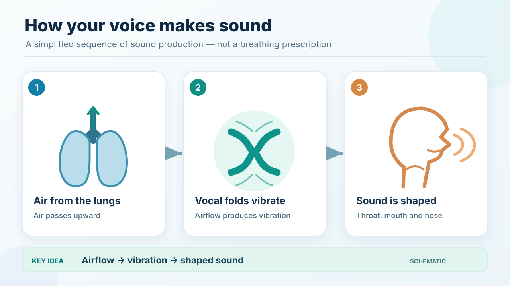
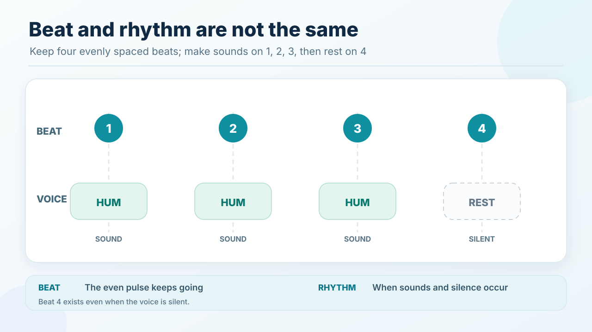
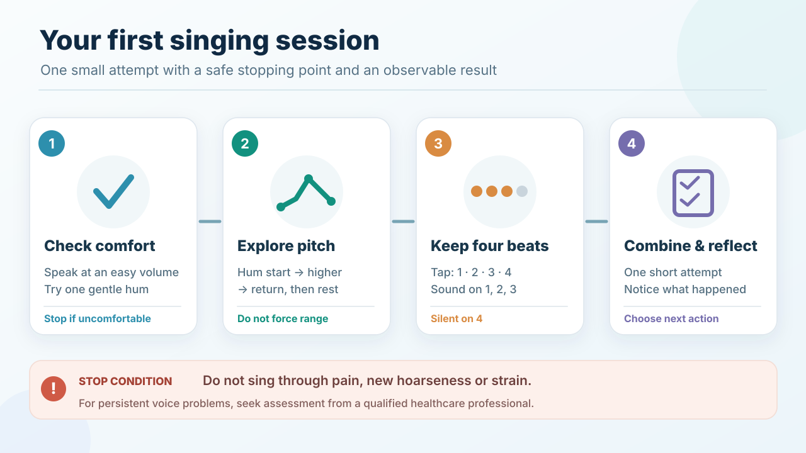

# Visual guide to singing foundations

## Key takeaway

Four compact, editable vector illustrations help a beginner see the distinctions used in the first singing Practice.

## Summary

The drawings are original Singing KPS SVG artwork. They are local, readable without plug-ins and explained below so that illustrations are optional for understanding. They clarify explanatory relations rather than demonstrating a validated vocal technique.

## Voice production

The left-to-right arrow means an explanatory sequence: airflow from the lungs supports vocal fold vibration, and the resulting sound is shaped by resonating spaces of the throat, mouth and nose. This is a **schematic**, not an anatomical cutaway, breathing instruction or medical examination. The underlying explanation is in [Voice production](../concepts/voice-production.md).

## Pitch direction

The vertical axis represents *higher versus lower pitch*, not loudness. The horizontal axis represents time. No note names, frequencies or interval sizes are prescribed. See [Pitch](../concepts/pitch.md).

## Beat and rhythm

The blue markers stay evenly spaced through all four counts: the pulse continues while the voice is silent on the fourth beat. The lower row shows **sound, sound, sound, rest**. See [Beat and rhythm](../concepts/beat-and-rhythm.md).

## First session

The numbered cards show the *recommended* learning order. Comfort is a prerequisite for the vocal stages, and the full [First singing session](../practices/first-singing-session.md) contains the actual steps, observations and fallback decisions. Stop for pain, new hoarseness or strain, and seek professional advice for persistent voice problems.

## Source and rights

The diagrams are original editable SVG illustrations created for Singing KPS. The repository currently has no standalone LICENSE file; no specific reuse licence is asserted by these diagram descriptions. Their source files are the committed SVGs in `diagrams/`; they are not outputs of the optional D2 renderer. The core concepts are source-aligned through their nearby Reference records. No third-party artwork was copied. Visual self-review does not establish independent reader comprehension.
