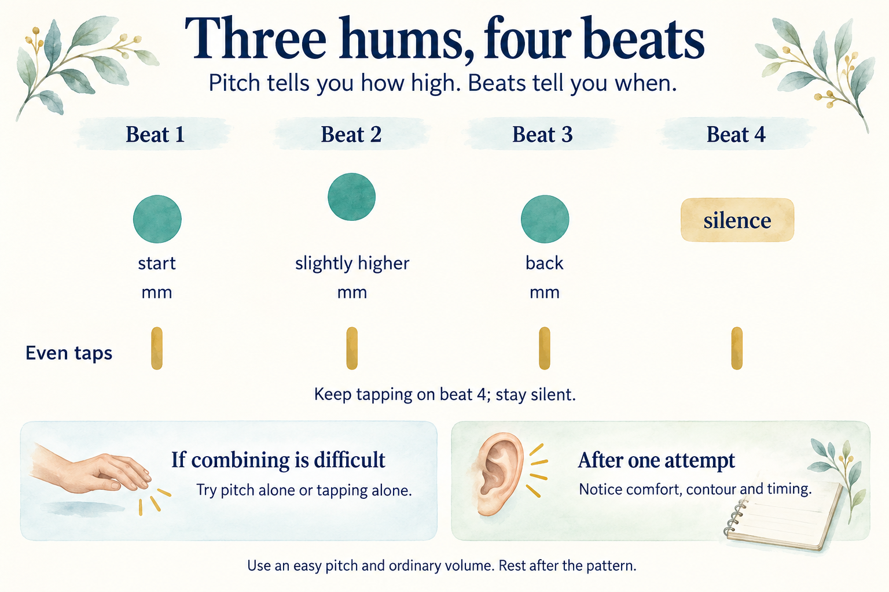

# First singing session

## Key takeaway

Make a comfortable three-note humming pattern over four beats, then notice pitch direction, timing and voice comfort separately.

## Summary

This short task is for someone with no previous singing instruction. Start with one easy vocal sound; change it slightly higher and back; add a simple pulse; and record what you actually noticed. No note names or external audio files are prerequisites. The output is one attempt and a brief observation, not a validated skill score or a promise of improvement.

## Starting conditions

Choose a quiet place and use your natural, comfortable speaking volume. A phone recorder is optional. Do not attempt the vocal stages if your voice is currently hoarse, painful, unusually tired or strained; rest and seek clinical advice if voice problems persist. Avoid forcing high or low notes, prolonged breath holding, loud projection and repeating until fatigued. See the [NIDCD safety record](../references/nidcd-2025-taking-care-of-your-voice.md).

Stage order is **recommended**, not an obligation to finish in one sitting. The actual **prerequisite** for continuing to a vocal stage is that the previous sounds felt comfortable. If an exercise is painful, stop rather than adapting it through force. Choose rest or qualified individual instruction when the safe entry condition is not met.

## Session illustration


The pictures summarise the steps below. The phone illustrates optional recording; no device is required. Continue only while comfortable.

## Stage map

1. [Stage1 Check voice comfort](#stage1-check-voice-comfort)
2. [Stage2 Explore pitch direction](#stage2-explore-pitch-direction)
3. [Stage3 Feel four beats](#stage3-feel-four-beats)
4. [Stage4 Combine and review](#stage4-combine-and-review)

## Stage1 Check voice comfort

**Steps**

1. Say a short ordinary sentence at your easy speaking volume. Notice whether it feels normal or uncomfortable.
2. If your voice feels comfortable, make one gentle **mm** hum for about one second on any easy pitch; then rest. You do not need a large breath or a particular note.
3. Write **comfort yes**, **comfort unsure** or **comfort no**. Continue with vocal sounds only if the answer is **yes**. For unsure or no, stop the vocal work; you may still do the silent listening and finger-tapping parts.

**Interpretation:** This is a self-observation, not a voice-health diagnosis. Hoarseness, soreness, strain, a sudden loss of range or effortful speaking justify stopping and consulting a professional rather than training through the symptom.

## Stage2 Explore pitch direction

**Steps**

1. Gently hum your easy starting pitch for a moment, then pause.
2. Hum a *slightly higher-sounding* pitch without becoming louder; pause. Hum again near the first pitch. Treat these as three separate short sounds, not one long held breath.
3. Say or jot down the shape you intended: **start, higher, back**. If you have a recorder, capture one attempt and listen for a clear rise followed by a return toward the start.
4. If you are unsure which sound was higher, do not force a bigger change. Rest, try a comfortable spoken **mm-hmm** inflection, or ask another person to demonstrate. If voice comfort becomes uncertain, stop.

**Interpretation:** Hearing a rise and return is a useful observation, but it does not yet show accurate matching to an external musical pitch. [Pitch](../concepts/pitch.md) explains the difference.

## Stage3 Feel four beats

**Steps**

1. Tap four relaxed, roughly even beats on a table or leg and count aloud **one, two, three, four** at a comfortable pace.
2. Speak **la** quietly on beats one, two and three; stay silent on four. This is a rhythm exercise, not a vocal range exercise.
3. If the beats feel uneven, remove the **la** and tap alone, more slowly. Repeat the pattern once only if comfortable.

**Interpretation:** Three sounds plus a rest form a rhythm within the recurring pulse. [Beat and rhythm](../concepts/beat-and-rhythm.md) explains both parts.

## Stage4 Combine and review



Circle height shows pitch direction, not loudness or a measured interval. The first and third circles show the intended return toward the starting pitch; they are not measured results. The gold marks show the continuing beat, including the silent fourth beat.

**Steps**

1. Tap four comfortable beats. On beat one hum the starting note, on beat two hum slightly higher, on beat three return toward the starting note, and on beat four stay silent. Rest after the pattern.
2. If combining pitches and tapping is difficult, practise the pitch direction without a pulse or the tapping without sung pitch. Recombine only when both feel manageable; slowing down is acceptable.
3. If possible, record one attempt and listen once. Note **voice comfort yes or no**, **contour up then down or uncertain**, and **pulse roughly even or uncertain**. Without a recording, mark the observations as unaided and uncertain where necessary.
4. Choose one next action: **stop and rest** if anything felt strained; revisit Stage2 for uncertain pitch direction; revisit Stage3 for timing; or try one easy recording on another day if comfortable.

**Synthetic example log**

```text
Date: [blank]
Comfort: [yes / unsure / no]
Pitch direction: [up then down / uncertain]
Beat: [roughly even / uncertain]
Recording reviewed: [yes / no]
Next action: [rest / Stage2 / Stage3 / repeat on another day]
```

## Current practice summary

No learner attempt, success, injury or practice result has been observed or recorded. The sample log is blank. Add actual observations only after a real session.

## Source basis and limits

[NIDCD Taking Care of Your Voice](../references/nidcd-2025-taking-care-of-your-voice.md) supports the general voice-production explanation and safety boundaries. [Open Music Theory Sight Singing](../references/open-music-theory-undated-sight-singing.md) recommends slowing down and separating rhythm from pitch when they interfere with one another. The starting pitch, pattern, stage order, pacing and checklist are local teaching choices. The sources do not establish this exercise as an optimal method, a therapeutic protocol or a measured improvement programme.

The two original AI-generated illustrations explain this existing task; they add no new vocal procedure, observed performance or evidence of effectiveness. Generation prompts are saved for the [session overview](../diagrams/first-singing-session-overview.prompt.txt) and [pitch and beat pattern](../diagrams/first-singing-session-pattern.prompt.txt).
